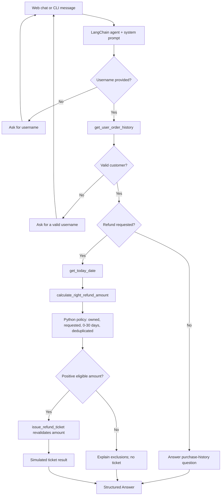
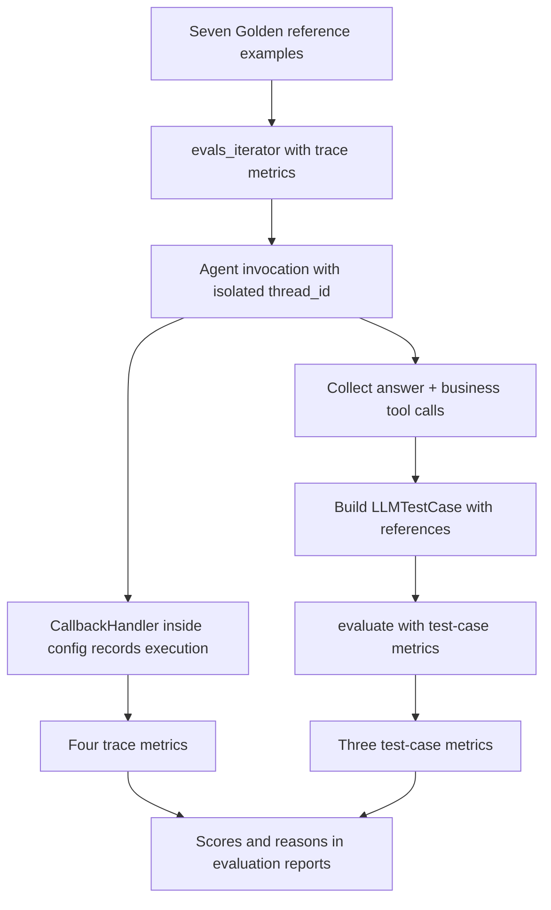

# Refund Lab · AIAgente

**A tool-driven customer-support assistant with inspectable decisions and
evaluation-first engineering.**

Python 3.14+ · LangChain · LangGraph · Streamlit · DeepEval

Refund Lab explores a practical question: **how do you build an AI assistant that
does more than produce a convincing answer?** The agent looks up purchases,
calculates policy-compliant refunds, and simulates ticket creation. A separate
evaluation suite checks its actions as well as its answers.

Start with the **no-key policy explorer**, then connect your own model for live
chat. Everything runs locally after cloning.

> **Sandbox only.** Customers are synthetic, tickets are simulated, and no money
> moves. Usernames are not authentication. This is a portfolio demonstration,
> not a production refund or payment service.

## What to explore

| Experience | What it demonstrates |
|---|---|
| Offline web explorer | Deterministic refund decisions, item-level exclusion reasons, editable reference dates |
| Live agent chat | Tool calling, structured responses, per-conversation memory, visible tool arguments |
| CLI | A packaged entry point for both the offline policy demo and live conversations |
| Evaluation suite | Seven reference scenarios and seven execution/answer metrics |
| Offline tests and CI | Policy boundaries, graph execution, UI behavior, runner wiring, and package checks without API keys |

### Engineering decisions

- **Policy outside the prompt.** Python enforces purchase ownership, the inclusive
  30-day window, future-date rejection, and duplicate-item deduplication.
- **Validate at the action boundary.** The simulated ticket tool recalculates the
  eligible amount and rejects unknown users, nonpositive amounts, and mismatched
  totals instead of trusting an LLM-supplied number.
- **Inspect the process and the outcome.** Trace metrics evaluate execution;
  test-case metrics evaluate answers and tool calls.
- **Separate deterministic and live experiences.** The offline explorer is
  explicitly not a chatbot and does not pretend to demonstrate model quality.
- **No import-time model requests.** Models and graph state are created explicitly;
  importing the packages does not start a conversation or evaluation.
- **Reproducible reference scenarios.** Evaluations use October 22, 2026, regardless
  of today's date, so the sample purchases do not silently age out.

## Quick start: no API key

Requirements: [uv](https://docs.astral.sh/uv/) and Python 3.14 or newer.
Run these commands from the cloned repository root:

```bash
uv sync --locked --group dev
uv run streamlit run app.py
```

Open **http://localhost:8501**. The app binds to loopback for local use.

In **Policy explorer**, the defaults request `backpack, water_bottle` for
`user126` on `2026-10-22`. The eligible amount is **$45**: the backpack qualifies,
and the water bottle is outside the refund window. Try `folder` for `user129`
to see a future-dated purchase rejected.

Prefer a terminal?

```bash
uv run aiagente --demo
uv run aiagente --demo --user user123 --items book pen
uv run aiagente --demo --user user129 --items folder --date 2026-10-22
```

The CLI demo prints the policy quote as JSON. It does not call an LLM or issue
a ticket.

## Connect your own model

You are not required to use one particular model. Choose a LangChain-compatible
chat model that supports **tool calling and structured output**. Small local
models and some hosted models may not support both reliably.

1. Copy the configuration template:

   ```bash
   cp .env.example .env
   ```

2. Set the agent model, provider, and provider-specific credentials. For example,
   with the already installed OpenAI integration:

   ```dotenv
   AGENT_MODEL=gpt-4.1-mini
   AGENT_MODEL_PROVIDER=openai
   OPENAI_API_KEY=your_key_here
   EVAL_MODEL=gpt-4.1-mini
   ```

   This is an example, not a required model or a guarantee of account access.
   Use a model identifier available to your account.

3. For a different provider, install its LangChain integration and follow that
   provider's authentication instructions. For example:

   ```bash
   uv add langchain-anthropic
   ```

   Then set `AGENT_MODEL_PROVIDER=anthropic`, a supported `AGENT_MODEL` identifier,
   and `ANTHROPIC_API_KEY`. Other providers follow the same pattern; additional
   endpoint or model-specific settings may require updating
   [build_model](agent/models.py).

4. Restart the app and select **Live agent chat**, or start the CLI:

   ```bash
   uv run aiagente --date 2026-10-22
   ```

   Example message: `I am user126. Please refund my backpack and water_bottle.`

The web chat defaults to the fixed demo date. Turn off that option to use the
system date; the live CLI uses the system date unless `--date` is supplied.
Changing the web reference-date mode starts a new conversation.

### Agent model vs. evaluator model

`AGENT_MODEL` controls the assistant; `EVAL_MODEL` controls the DeepEval judge.
They are separate integrations. Setting the agent provider does **not** configure
DeepEval's judge provider automatically.

The default evaluator factory passes `EVAL_MODEL` to DeepEval. For a non-default
judge backend, configure a supported
[DeepEval model integration](https://deepeval.com/docs/metrics-introduction), or
adapt [evaluation/model.py](evaluation/model.py) to return a
`DeepEvalBaseLLM` implementation. Check structured-output support and provider
credentials for the judge independently.

**Privacy and cost:** live chat and evaluations send messages, synthetic purchase
data, and evaluation prompts to your configured providers and may incur API
charges. Keep API keys in your local `.env`; never put real customer data or
credentials into prompts or reference scenarios.

## Workflow

### Agent and policy flow



The graph illustrates the intended workflow, not a hard-coded order of model
decisions. Policy rules and ticket-amount validation are enforced in Python;
tool selection remains the model's responsibility.

`InMemorySaver` stores conversation state in process memory. A unique `thread_id`
isolates each conversation and each evaluation example. Restarting the process
loses this state.

Responses use the Pydantic `Answer` schema:

```python
Answer(
    answer="A simulated refund ticket for $23 has been issued.",
    conversation=False,
)
```

The `conversation` flag indicates whether the assistant needs more information.
The CLI lets the user continue asking questions until `/exit`.

## Evaluation

### Two stages, seven metrics



| Stage | Metric | Question |
|---|---|---|
| Trace | Task Completion | Did the agent complete the request under the refund policy? |
| Trace | Step Efficiency | Were the execution steps useful rather than redundant? |
| Trace | Plan Quality | Was the planning evidenced by the trace appropriate? |
| Trace | Plan Adherence | Did execution follow the planning evidenced by the trace? |
| Test case | Argument Correctness | Were the tool arguments appropriate for the request? |
| Test case | Tool Correctness | Did the business tool calls match the expected ordered sequence? |
| Test case | G-Eval: Answer Correctness | Did the actual answer reach the same conclusion as the reference? |

All metrics use a **0.8 threshold**. Tool correctness considers ordering; the
dataset supplies tool-name references rather than full argument-level expected
values. Argument correctness judges actual arguments separately. Internal
structured-response tool calls are excluded from business-tool comparisons.

G-Eval checks semantic correctness, not exact wording. A relevant answer can
still be wrong about an amount or ticket status. Planning scores depend on what
is observable in the trace; this project does not implement a separate explicit
planner.

### Reference scenarios

| Scenario | Expected outcome on 2026-10-22 |
|---|---|
| User123: book and pen | Simulated ticket for $30 |
| User123: book only | Simulated ticket for $23 |
| User123: purchase history, explicitly no refund | List purchases without a ticket |
| Unknown user999 | Request a valid username |
| User126: expired water bottle | Deny refund |
| User126: backpack and expired water bottle | Simulated ticket for backpack only, $45 |
| User123: sneakers not purchased | Deny refund |

### Run live evaluations

Configure both agent and judge credentials first:

```bash
uv run aiagente-eval
uv run aiagente-eval --metric answer_correctness
uv run python -m evaluation.task_completion
```

All individual metric modules delegate to the shared runner. Prefer the installed
command or `python -m evaluation.<module>` over executing package files by path.

The combined run produces separate trace and test-case reports, with fresh
conversations for every scenario. Cache reads/writes and the post-run inspection
prompt are disabled. API/provider errors are not converted into passing results.

**Result transparency:** offline tests validate implementation and wiring; they
do not benchmark a live LLM. No live-model accuracy or seven-metric pass rate is
claimed here. Run the evaluation with your chosen models before publishing
benchmark results. Judge scores can vary across models and runs.

## Development and CI

```bash
uv run pytest -q
uv run ruff check .
uv run ruff format --check .
uv build
```

The [GitHub Actions workflow](.github/workflows/ci.yml) runs these offline checks
on pushes and pull requests, plus the CLI demo. No provider secrets are needed
in CI.

Coverage includes inclusive 30-day boundaries, future purchases, unknown users,
unowned/expired items, duplicate requests, ticket-amount mismatches, real graph
execution using a scripted model, isolated threads, evaluation callback wiring,
and Streamlit UI interactions.

### Project layout

```text
app.py                    Streamlit policy explorer and live chat
agent/
  agent.py                Agent factory and in-memory checkpointer
  cli.py                  Installed CLI entry point
  policy.py               Deterministic refund rules
  tools.py                LangChain tool definitions and ticket validation
  models.py               Lazy model configuration
  objects.py              Structured input/output schemas
  data.py                 Synthetic purchases
  prompts.py              Assistant instructions
evaluation/
  dataset.py              Seven Golden examples
  eval_all.py             Shared metric construction and evaluation runner
  model.py                Judge configuration
  <metric>.py             Individual metric entry points
tests/                    Offline policy, graph, evaluation, and UI tests
.github/workflows/ci.yml   Automated checks
```

## Scope and next steps

- **No authentication, payments, or persistent ticket store.** A repeated valid
  request can produce another simulated success. Real integrations would need
  authenticated identity, transaction tracking, idempotency, and authorization.
- **No deployment claim.** The app is intended for local use, not public exposure.
- **Finite synthetic dataset.** Prices are integer demo dollars, not a complete
  currency or order-line model. There are no quantities, taxes, or shipping rules.
- **Model support varies.** A provider integration alone does not guarantee tool
  calling, structured responses, or comparable evaluation quality.
- **Future extensions:** multi-turn evaluation scenarios, explicit planning,
  durable state, authenticated customer lookup, and approved payment integrations.

### Portfolio summary

> Built a local, tool-driven refund assistant with a Streamlit demo, deterministic
> business-policy enforcement, structured LangChain responses, isolated LangGraph
> conversations, and a seven-metric DeepEval workflow. Added offline regression
> tests and CI so reviewers can explore the core behavior without API credentials.
