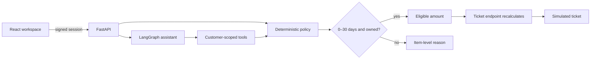

# Refund Lab · AIAgente

**An inspectable, policy-driven refund platform that separates conversational AI from business authority.**

Refund Lab demonstrates how an AI support experience can remain useful without trusting a language model to calculate or approve money. A React workspace guides a synthetic customer through a refund request, a deterministic Python policy decides eligibility, and a FastAPI action boundary recalculates every amount before creating a simulated ticket.

> **Portfolio demonstration:** all customers and purchases are synthetic, authentication is a public demo gateway, tickets are simulated, and no payment is processed.

## Product experience

- Public product narrative explaining the trust boundary and evaluation strategy.
- Signed demo login that scopes every browser request to one synthetic customer.
- Interactive order selection with item-level eligibility and exclusion reasons.
- Server-authoritative refund quotes and amount revalidation at ticket creation.
- Optional LangGraph policy assistant with visible business-tool traces.
- Seven fixed reference scenarios evaluated across seven DeepEval metrics.
- Offline policy, API, graph, CLI, and frontend tests that require no model key.

Demo credentials:

```text
Username: user126
Password: refund-demo
```

The password is intentionally public. The demo still uses a signed, HTTP-only session cookie to model a responsible browser/server boundary; it is not a production identity system.

## Why the system is designed this way

The model can interpret a request, choose tools, and explain an outcome. It cannot change the refund window, invent ownership, or authorize an arbitrary amount.



Core safeguards:

1. The authenticated customer comes from the signed session, never from a browser-supplied user ID.
2. Purchase ownership, future dates, the inclusive 30-day window, and duplicate items are handled in Python.
3. Web-agent tools reject attempts to access a different synthetic customer.
4. Ticket creation recalculates the quote and rejects a stale or modified amount.
5. Model failures affect the optional assistant—not the deterministic refund workflow.

## Technology

| Layer | Stack |
|---|---|
| Product UI | React 19, TypeScript, Vite, React Router |
| API and sessions | FastAPI, Pydantic, ItsDangerous |
| Agent | LangChain, LangGraph, structured output |
| Policy | Deterministic Python and synthetic purchase fixtures |
| Evaluation | DeepEval trace and test-case metrics |
| Quality | Pytest, Ruff, Vitest, Testing Library, GitHub Actions |
| Delivery | Single-container frontend build and FastAPI runtime |

Python 3.14 or newer and Node.js 22 are used by the project.

## Run locally

Requirements: [uv](https://docs.astral.sh/uv/), Python 3.14+, and Node.js 22+.

```bash
git clone <your-repository-url>
cd AIAgente
cp .env.example .env
uv sync --locked --group dev
cd frontend && npm install && cd ..
```

Start the API:

```bash
uv run uvicorn api.app:app --reload
```

In a second terminal, start the frontend:

```bash
cd frontend
npm run dev
```

Open [http://localhost:5173](http://localhost:5173). Vite proxies `/api` requests to FastAPI on port 8000.

The deterministic refund experience works without model credentials. To use the assistant panel, configure a tool-capable model in `.env`:

```dotenv
AGENT_MODEL=gpt-4.1-mini
AGENT_MODEL_PROVIDER=openai
OPENAI_API_KEY=your_key_here

SESSION_SECRET=replace-with-a-long-random-value
SESSION_COOKIE_SECURE=false
APP_ENV=development
```

Model identifiers are examples and depend on provider/account availability. Live assistant and evaluation calls can incur API charges and send synthetic prompts to the configured provider.

## Run with Docker

The production image builds the frontend and serves it from FastAPI as one application:

```bash
docker build -t refund-lab .
docker run --rm -p 8000:8000 \
  -e SESSION_SECRET="$(openssl rand -hex 32)" \
  refund-lab
```

Open [http://localhost:8000](http://localhost:8000). Production deployments must provide `SESSION_SECRET` and set `SESSION_COOKIE_SECURE=true` when serving the application over HTTPS.

## Deterministic policy

The reference date is fixed to **October 22, 2026** for repeatable demonstrations and evaluations.

| Rule | Behavior |
|---|---|
| Purchase age 0–30 days | Eligible, including day 30 |
| Purchase older than 30 days | Excluded as outside the window |
| Future-dated purchase | Excluded rather than producing a negative age refund |
| Item not owned | Excluded as not purchased |
| Duplicate item name | Evaluated once |
| Empty item | Rejected before evaluation |
| Modified ticket amount | Rejected and returned with the expected amount |

The packaged CLI exposes the same policy without the web application:

```bash
uv run aiagente --demo
uv run aiagente --demo --user user123 --items book pen
uv run aiagente --demo --user user129 --items folder --date 2026-10-22
```

## Agent and evaluation

The optional assistant uses four inspectable tools:

1. `get_user_order_history`
2. `get_today_date`
3. `calculate_right_refund_amount`
4. `issue_refund_ticket`

The browser-created agent is scoped to the authenticated demo customer. CLI and evaluation agents remain explicit sandbox interfaces that can exercise any synthetic fixture.

DeepEval assesses more than answer wording:

| Stage | Metrics |
|---|---|
| Trace | Task completion, step efficiency, plan quality, plan adherence |
| Test case | Argument correctness, ordered tool correctness, answer correctness |

All metrics use a `0.8` threshold. Seven goldens cover full refunds, partial refunds, exclusions, unknown customers, purchase-history questions, and non-owned items. Every scenario receives an isolated conversation and uses the fixed reference date.

Configure `EVAL_MODEL` separately from `AGENT_MODEL`, then run:

```bash
uv run aiagente-eval
uv run aiagente-eval --metric answer_correctness
```

No live-model score is claimed in this repository: judge results vary by model and run. Offline tests validate policy and integration wiring, not model quality.

## Quality checks

```bash
uv run ruff check .
uv run ruff format --check .
uv run pytest -q

cd frontend
npm run lint
npm test
npm run build
```

GitHub Actions runs the Python suite, offline CLI demonstration, frontend checks, production frontend build, and Python package build on pushes and pull requests.

## Repository map

```text
agent/       deterministic policy, customer tools, model and graph factory
api/         signed demo sessions, refund endpoints, agent endpoint, static delivery
frontend/    React product experience and component tests
evaluation/  goldens, trace metrics, answer/tool metrics, shared runner
tests/       offline policy, graph, CLI, API, and evaluation tests
```

## Deliberate limitations

- Demo accounts are seeded and have no registration, recovery, or durable identity store.
- Tickets and conversations are held in process memory and disappear on restart.
- Purchase data is fixture data, not a database or commerce integration.
- Ticket creation demonstrates validation but does not contact a support or payment system.
- Horizontal scaling would require shared conversation/session persistence.

These boundaries keep the portfolio honest: Refund Lab demonstrates policy-safe orchestration, inspectability, and evaluation—not production payment processing.
